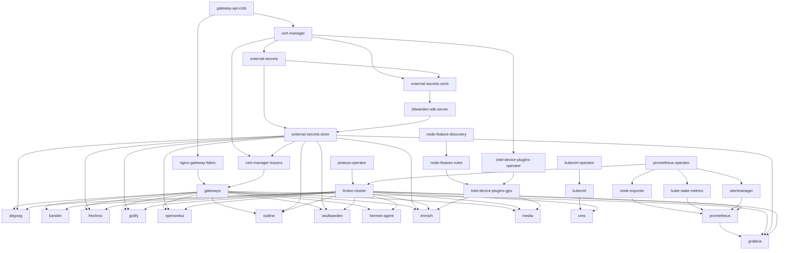

# k8s-flux

GitOps configuration for the homelab Kubernetes cluster(s), reconciled by
[Flux](https://fluxcd.io).

## Repository layout

```
clusters/          One directory per cluster, one subdirectory per environment (Flux entrypoint).
apps/              Application workloads.
vms/               KubeVirt virtual machines.
infrastructure/    Cluster infrastructure, one directory per deployable unit.
```

Each unit is a Kustomize `base/`; an env directory (`development/`, `production/`) exists only
when that environment diverges. `clusters/<cluster>/<env>/` is bootstrapped with
`flux bootstrap --path=clusters/<cluster>/<env>` and contains the generated `flux-system/`
(do not edit). `infrastructure.yaml`, `apps.yaml` and `vms.yaml` hold one Flux `Kustomization`
per unit; `dependsOn` (with `wait: true`) is the dependency graph.

## Clusters

- **bee** — active cluster.

## bee

Dependencies between units:



### Infrastructure

- `gateway-api-crds` — upstream Gateway API CRDs.
- `cert-manager` — cert-manager.
- `external-secrets`, `external-secrets-certs` — external-secrets operator and its certificates.
- `bitwarden-sdk-server` — Bitwarden Secrets Manager SDK server.
- `external-secrets-store` — `ClusterSecretStore` backed by Bitwarden.
- `cert-manager-issuers` — `letsencrypt` ClusterIssuer (DNS-01 via Cloudflare).
- `nginx-gateway-fabric` — Gateway API data plane (hostPort 80/443 on every node).
- `gateways` — shared `bee-gateway` for `*.xtinto.com`, HTTP redirected to HTTPS.
- `piraeus-operator`, `linstor-cluster` — LINSTOR storage (`local`, `replicated`).
- `prometheus-operator`, `node-exporter`, `kube-state-metrics`, `alertmanager`, `prometheus`,
  `grafana` — monitoring.
- `kubevirt-operator`, `kubevirt` — virtualization.
- `node-feature-discovery`, `node-feature-rules` — NFD plus an Intel `NodeFeatureRule` that
  labels GPU nodes (`intel.feature.node.kubernetes.io/gpu`). Split into two units because the
  rule's CRD is installed by the NFD HelmRelease.
- `intel-device-plugins-operator`, `intel-device-plugins-gpu` — Intel GPU device plugin
  (operator + `GpuDevicePlugin`), exposing `gpu.intel.com/i915`.

### Apps

- `degoog` — `search.xtinto.com`; depends on `gateways`, `external-secrets-store`, `linstor-cluster`.
- `kanidm` — `idm.xtinto.com`; depends on `gateways`, `linstor-cluster`.
- `freshrss` — `rss.xtinto.com`; depends on `gateways`, `external-secrets-store`,
  `linstor-cluster`. Official Debian image (OIDC needs `mod_auth_openidc`, which the Alpine variant
  lacks), SQLite on a `replicated` PVC, Kanidm OIDC with `auth_type: http_auth`: no local passwords.
  The Kanidm OAuth2 client `freshrss` exists with PKCE disabled (the image's Apache module does not
  implement PKCE); its secret and the session crypto key are stored manually in Bitwarden as
  `freshrss/oidc-client-secret` and `freshrss/oidc-crypto-key`. `freshrss-admin` is the default
  (admin) user; `martin.tome` is a normal user.
- `gotify` — `push.xtinto.com`; depends on `gateways`, `external-secrets-store`,
  `linstor-cluster`. Raw manifests, SQLite on a `replicated` PVC. Kanidm OIDC is available for
  members of the `gotify_users` group; local password login stays enabled for the `admin` account.
  The bootstrap admin password is generated once and stored in Bitwarden as
  `gotify/DEFAULTUSER_PASS`; the OAuth2 client secret is stored as `gotify/oidc-client-secret`.
  The Kanidm OAuth2 client `gotify` uses PKCE and has only the `gotify_users` group in its scope
  map; create it manually. Alertmanager delivery is not configured yet.
- `openwebui` — `chat.xtinto.com`; depends on `gateways`, `external-secrets-store`, `linstor-cluster`.
  Official Helm chart, SQLite on a `replicated` PVC, Kanidm OIDC. LLM connections are added later in
  the admin panel.
- `outline` — `docs.xtinto.com`; depends on `gateways`, `external-secrets-store`,
  `linstor-cluster`. Raw manifests with a bundled PostgreSQL 17 and Valkey 8 on `replicated` PVCs,
  local file storage and Kanidm OIDC. The Kanidm OAuth2 client `outline` already exists; its secret
  is stored manually in Bitwarden as `outline/oidc-client-secret`. Workspace data is imported in the
  admin settings from a JSON export of the old instance.
- `vaultwarden` — `passwords.xtinto.com`; depends on `gateways`, `external-secrets-store`,
  `linstor-cluster`. Official Helm chart, SQLite on a `replicated` PVC. Credentials are imported
  from the old instance via the web vault's export/import.
- `hermes-agent` — `hermes.xtinto.com`; depends on `gateways`, `linstor-cluster`. Nous Research's
  self-improving agent, run in gateway mode from the official `nousresearch/hermes-agent` image (no
  Helm chart). The dashboard UI/management API (Kanidm OIDC) is served at the site root and the
  OpenAI-compatible API under `/api/v1`; all state lives on a `replicated` PVC. NetworkPolicies
  default-deny both directions (cluster CIDRs are Flux `postBuild` variables) so the agent can only
  reach DNS, the internet and the gateway VIP (Kanidm), never other pods or the Kubernetes API. The
  model, the OpenRouter key and `API_SERVER_KEY` (generated on first boot) are all managed in the
  dashboard, not in Git.
- `immich` — `immich.xtinto.com`; depends on `gateways`, `external-secrets-store`,
  `linstor-cluster`, `intel-device-plugins-gpu`. Official OCI Helm chart with a bundled
  PostgreSQL 14 (VectorChord) StatefulSet and Valkey 9.1 on `replicated` volumes, OpenVINO
  machine learning with a persistent model cache, and QuickSync/VAAPI transcoding plus iGPU
  inference through the Intel GPU device plugin (`gpu.intel.com/i915`). Migrated from an existing
  v2.7.5 instance by restoring its database dump and library files into the `immich-library` PVC;
  chart and images are pinned at v2.7.5 until the restore is verified, then bumped to v3.3.1.
  Kanidm OIDC.
- `media` — Jellyfin and Arrmada: `jellyfin.xtinto.com`, `arrmada.xtinto.com`, `prowlarr.xtinto.com`;
  depends on `gateways`, `linstor-cluster`, `intel-device-plugins-gpu`. Arrmada replaces the separate
  Sonarr/Radarr/Lidarr/Bazarr/Seerr apps: one app manages libraries, requests and subtitles. Prowlarr,
  qBittorrent and FlareSolverr run as separate Deployments; Prowlarr's UI is routed, the other two are
  internal-only. Arrmada registers Prowlarr as its indexer manager and auto-adds qBittorrent and
  FlareSolverr on first start. There is no inbound torrent port. One shared 250Gi `ReadWriteMany`
  LINSTOR/NFS volume holds
  `/storage/media` and `/storage/downloads`, so Arrmada and qBittorrent hardlink imports and can run
  on either node. Arrmada keeps its database on a 20Gi `replicated` RWO PVC and qBittorrent its
  settings on a 2Gi one; Jellyfin keeps metadata on a 10Gi PVC. Jellyfin uses the Intel GPU for
  QuickSync/VAAPI transcoding, and Arrmada can use it for Convert and AI subtitles. Jellyfin and
  Arrmada each use their own login; the qBittorrent password is shown inside Arrmada.

### VMs

A VM lives in `vms/<cluster>/<vm>/base` with its own Kustomization in `vms.yaml`, depending on
`kubevirt` and `linstor-cluster` (plus `external-secrets-store` when cloud-init data comes from
an `ExternalSecret`).

## Secrets

No plaintext secrets. All secrets go through external-secrets backed by Bitwarden
(`ClusterSecretStore: bitwarden-secrets-manager`). Anything committed here is compromised:
remove and rotate it. `external-secrets-store` becomes Ready only after the
`bitwarden-access-token` Secret exists in `external-secrets` (a manual bootstrap step).
